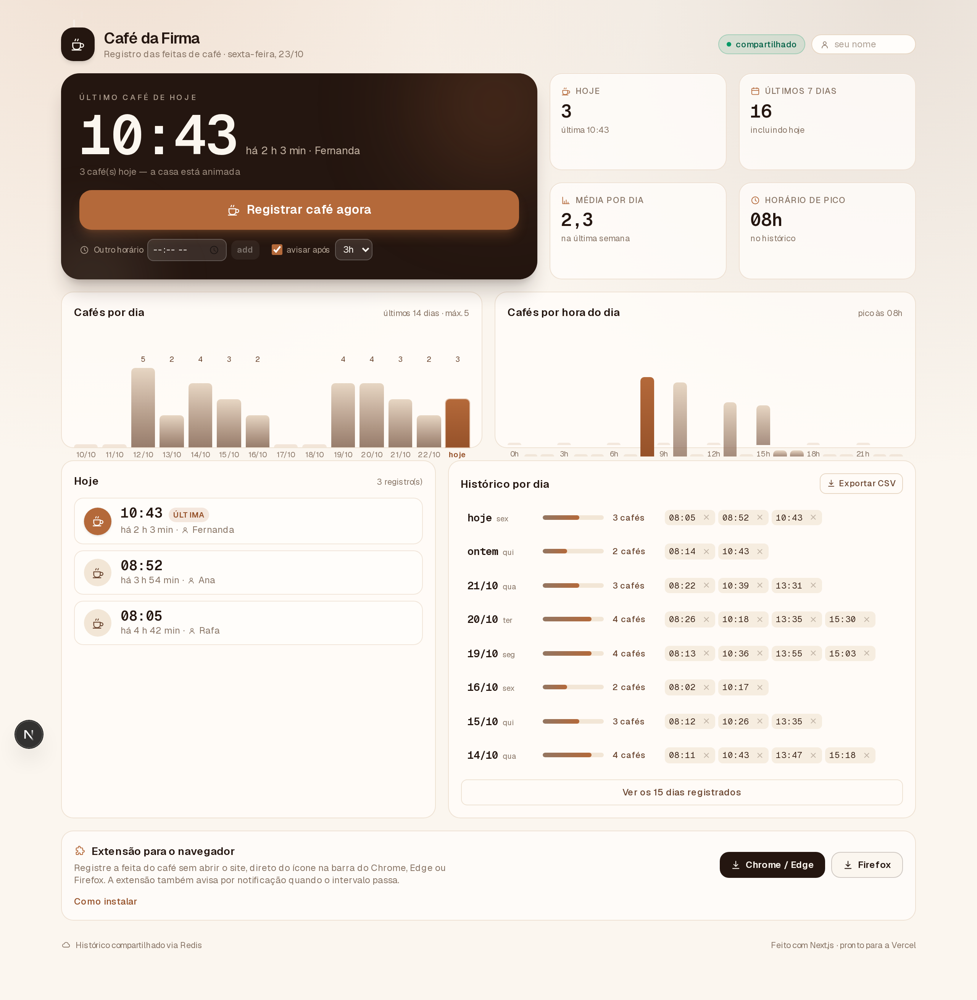
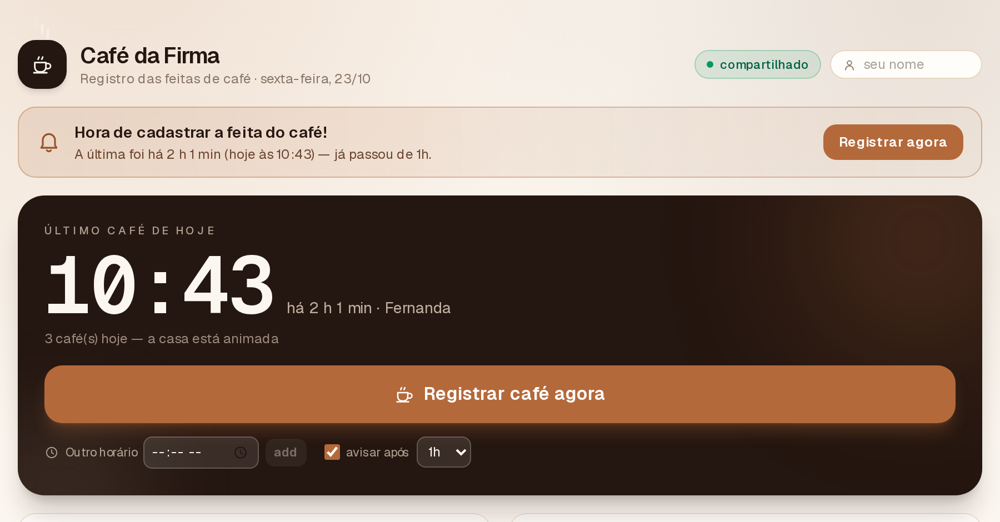
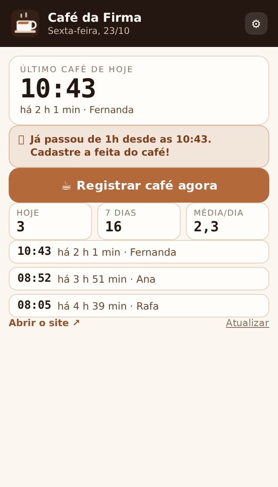

# ☕ Café da Firma

[](https://github.com/Amad3eu/cafedafirma/actions/workflows/ci.yml)
[](LICENSE)
[](https://nextjs.org)

Site para registrar as **feitas de café** da empresa: um clique registra o horário, um aviso aparece quando o intervalo passa, e um histórico com gráficos mostra quantos cafés foram feitos por dia e em que horário.

Feito com **Next.js 16 (App Router) + React 19 + Tailwind CSS 4**, pronto para hospedar na **Vercel**, com **extensão para Chrome, Edge e Firefox** incluída.



| Aviso de "hora do café" | Extensão no navegador |
| --- | --- |
|  |  |

---

## ✨ O que ele faz

- **Registrar café agora** — grava só o horário (e opcionalmente quem registrou). Também dá para registrar um horário passado ("Outro horário").
- **Aviso de "hora de cadastrar a feita"** — banner que aparece quando o último café passou do intervalo configurado (1h a 6h, ajustável na tela). Na extensão o mesmo aviso chega como notificação do navegador.
- **Cartão do último café** — horário em destaque, "há quanto tempo" e quem registrou.
- **Hoje** — lista dos cafés do dia, com botão para remover (e "Desfazer" no aviso que aparece após registrar).
- **Histórico por dia** — agrupado por data, com todos os horários, quantidade por dia e atalho para remover registros errados.
- **Gráficos** — cafés por dia (últimos 14 dias) e cafés por hora do dia, com destaque para o horário de pico.
- **Métricas** — hoje, últimos 7 dias, média por dia, horário de pico.
- **Exportar CSV** — baixa todo o histórico (`;` como separador, abre direto no Excel em pt-BR).
- **Funciona offline / sem banco** — se não houver banco configurado, o histórico fica no `localStorage` do navegador e o app avisa isso na tela.
- **Migração automática** — quando o banco é conectado, o app oferece importar para o histórico compartilhado os cafés que estavam salvos só no navegador (ou descartá-los).
- **Extensão de navegador** — registra o café sem abrir o site (clique no ícone, menu de contexto ou `Alt+Shift+C`), mostra o último café + contador do dia, avisa por notificação quando o intervalo passa, lembra o primeiro café do dia e avisa quando um colega registra (ex.: “Amadeu fez café ☕”).

---

## 🚀 Rodar localmente

Requisitos: Node.js 20.9+ (recomendado 20 ou 22).

```bash
npm install
npm run dev
```

Abra http://localhost:3000.

Em desenvolvimento, os cafés são salvos em `data/entries.json` (modo arquivo). Para começar com dados de exemplo:

```bash
node scripts/seed-demo.cjs          # gera ~3 semanas de histórico de exemplo
node scripts/seed-demo.cjs --clear  # limpa tudo
```

Scripts disponíveis:

| Comando | O que faz |
| --- | --- |
| `npm run dev` | servidor de desenvolvimento |
| `npm run build` | build de produção |
| `npm start` | roda o build de produção |
| `npm run lint` | ESLint |
| `node scripts/make-icons.cjs` | regenera os ícones (app + extensão) |
| `node scripts/seed-demo.cjs` | dados de exemplo / `--clear` limpa |

---

## ☁️ Deploy na Vercel

### 1. Suba o projeto para um repositório

```bash
cd cafe-tracker
git init
git add .
git commit -m "Café da Firma"
git branch -M main
git remote add origin https://github.com/SEU-USUARIO/cafe-da-firma.git
git push -u origin main
```

### 2. Importe na Vercel

1. Entre em <https://vercel.com/new>.
2. Escolha o repositório **cafe-da-firma**.
3. Framework detectado automaticamente: **Next.js** — não precisa mexer em nada (build `next build`).
4. Clique em **Deploy**.

Ou, pelo terminal:

```bash
npm i -g vercel
vercel        # preview
vercel --prod # produção
```

### 3. Crie o banco de dados (histórico compartilhado) ⚠️ importante

Sem banco, o site funciona, mas **cada pessoa vê só os próprios cafés** (ficam no navegador de cada um). Para o histórico ser o mesmo para a equipe toda:

1. No painel do projeto na Vercel, vá em **Storage** (ou *Marketplace*) → **Create Database** → **Upstash Redis** (plano gratuito serve bem).
2. Conecte o banco ao projeto — a Vercel injeta as variáveis automaticamente:
   - `UPSTASH_REDIS_REST_URL`
   - `UPSTASH_REDIS_REST_TOKEN`

   (Também funciona com os nomes `KV_REST_API_URL` / `KV_REST_API_TOKEN`.)
3. Faça um **Redeploy** (Deployments → ⋯ → Redeploy) para o app pegar as variáveis.

Pronto: o selo no topo do site passa de *"só neste navegador"* para **"compartilhado"**, e o histórico vale para todo mundo. O app guarda os últimos 12 meses automaticamente.

### Variáveis de ambiente

| Variável | Obrigatória | Para quê |
| --- | --- | --- |
| `UPSTASH_REDIS_REST_URL` | não (recomendada) | endpoint REST do Redis |
| `UPSTASH_REDIS_REST_TOKEN` | não (recomendada) | token do Redis |
| `KV_REST_API_URL` / `KV_REST_API_TOKEN` | não | alternativa (Vercel KV) |
| `STORAGE_URL` / `STORAGE_TOKEN` | não | integração criada com prefixo `STORAGE` |
| `<PREFIXO>_URL` / `<PREFIXO>_TOKEN` | não | qualquer prefixo customizado da integração |
| `CAFE_FILE_STORE=1` | não | força salvar em arquivo mesmo em produção (só use em servidor próprio) |
| `PRIVACY_CONTACT` | não | e-mail exibido na página `/privacidade` (padrão: `privacidade@cafedafirma.local`) |

> O app detecta automaticamente o par certo: procura primeiro os nomes conhecidos e,
> se não achar, varre o ambiente atrás de uma variável `*_URL` apontando para o Upstash
> com o token correspondente. Ou seja, **não importa o prefixo** escolhido na hora de
> conectar o banco (Production/Preview/Development).

Veja `.env.example`.

---

## 🧩 Extensão do navegador

O código está em `extension/chrome` e `extension/firefox` (mesmos arquivos, só o `manifest.json` muda). Os zips prontos ficam em `public/` e também são baixados pelo próprio site, no card **"Extensão para o navegador"**.

- `public/extensao-cafe-chrome.zip`
- `public/extensao-cafe-firefox.zip`

Depois de mexer no código da extensão, gere os zips de novo:

```bash
npm run build:ext
```

### Instalar no Chrome / Edge (modo desenvolvedor)

1. Baixe e **descompacte** `extensao-cafe-chrome.zip`.
2. Abra `chrome://extensions` (ou `edge://extensions`).
3. Ligue o **Modo do desenvolvedor** (canto superior direito).
4. Clique em **Carregar sem compactação** e escolha a pasta descompactada.
5. Clique no ícone da extensão → **⚙ Configurações** → cole o endereço do seu site (ex.: `https://cafe-da-firma.vercel.app`) → **Salvar** → **Testar conexão**.

### Instalar no Firefox

1. Baixe `extensao-cafe-firefox.zip` e descompacte.
2. Abra `about:debugging#/runtime/this-firefox`.
3. **Carregar complemento temporário** → selecione o `manifest.json` da pasta.
4. Nas opções da extensão, cole o endereço do site e salve.

> No Firefox, complementos carregados assim são temporários (desaparecem ao fechar o navegador). Para uso fixo da equipe, publique na [AMO](https://addons.mozilla.org/developers/) (a extensão já tem `id` e `strict_min_version` definidos) ou instale em cada máquina.

### O que a extensão faz

- **Popup**: último café + "há quanto tempo", contador de hoje, 7 dias e média, aviso laranja quando passou do intervalo, botão **Registrar café agora**, lista dos últimos cafés do dia e atalho para o site.
- **Badge no ícone**: número de cafés de hoje.
- **Notificação** a cada verificação (5 em 5 minutos) quando o intervalo configurado passou; clicar abre o site.
- **Opções**: endereço do site, seu nome, intervalo do aviso (1h a 6h) e botão de teste de conexão.

---

## 🧩 Extensão: instalar, publicar e como o sistema funciona

Guia detalhado em [docs/EXTENSAO-E-SISTEMA.md](docs/EXTENSAO-E-SISTEMA.md): arquitetura,
fluxos, instalação em 2 minutos (carregar sem compactação), publicação no Chrome Web Store,
Edge Add-ons e Firefox AMO (com checklist e justificativa de permissões) e o checklist pós-deploy.

## 🔌 API

Todas as rotas aceitam CORS (`Access-Control-Allow-Origin: *`), para a extensão conseguir chamar o site.

### `GET /api/entries?days=60`

```json
{
  "storage": "redis",
  "entries": [{ "id": "uuid", "ts": 1761214980000, "who": "Ana" }]
}
```

`storage` pode ser `redis` (compartilhado), `file` (dev) ou `none` (sem banco → o app usa o navegador).

### `POST /api/entries`

```json
{ "ts": 1761214980000, "who": "Ana" }
```

`ts` é opcional (padrão: agora; limitado aos últimos 60 dias). Resposta:

```json
{ "storage": "redis", "entry": { "id": "uuid", "ts": 1761214980000, "who": "Ana" } }
```

### `DELETE /api/entries?id=uuid`

```json
{ "storage": "redis", "removed": true }
```

Exemplo rápido com curl:

```bash
curl -X POST https://SEU-SITE.vercel.app/api/entries \
  -H 'Content-Type: application/json' -d '{"who":"Ana"}'
curl "https://SEU-SITE.vercel.app/api/entries?days=7"
```

---

## 🗂 Estrutura

```
cafe-tracker/
├─ app/
│  ├─ api/entries/route.ts   # GET / POST / DELETE do histórico
│  ├─ layout.tsx             # fontes, metadata, CSS global
│  ├─ page.tsx               # página principal (server) → <CoffeeApp />
│  ├─ icon.png               # favicon gerado
│  └─ globals.css            # Tailwind 4 + tokens de cor (café)
├─ components/
│  ├─ CoffeeApp.tsx          # estado, ações, avisos, layout
│  ├─ DayChart.tsx           # gráfico de cafés por dia
│  ├─ HourChart.tsx          # gráfico de cafés por hora
│  ├─ TodayList.tsx          # cafés de hoje
│  ├─ HistoryList.tsx        # histórico agrupado por dia
│  ├─ StatCard.tsx           # cartões de métrica
│  ├─ ExtensionCard.tsx      # card de download/instruções da extensão
│  └─ Icons.tsx              # ícones SVG (sem dependências)
├─ lib/
│  ├─ store.ts               # persistência: Redis → arquivo → nenhum
│  ├─ redis.ts               # cliente REST do Upstash/Vercel KV (só fetch)
│  ├─ client-store.ts        # fetch + fallback localStorage + settings
│  ├─ format.ts              # datas, horas, "há x min", rótulos
│  └─ types.ts
├─ extension/
│  ├─ chrome/                # manifest MV3 + popup + options + background
│  └─ firefox/               # idem, com manifest MV3 para o Gecko
├─ public/                   # zips das extensões + ícone
├─ scripts/                  # geração de ícones e dados de exemplo
└─ data/                     # (dev) entries.json — não vai para o git
```

---

## 🔐 Observações e próximos passos

- **Não há login**: quem tem o link registra e vê o histórico. Para uso interno, deixe o link só com a equipe. Se precisar de controle, os caminhos naturais são: Vercel Password Protection (plano Pro), um `?token=` na URL ou login com GitHub/e-mail.
- O app guarda no máximo **12 meses** de histórico (limpeza automática no Redis).
- Horários usam o **fuso do navegador** de quem registra/visualiza.
- Ideias para depois: ranking de quem mais fez café no mês, tipos de café (expresso, coado...), "quem faz o próximo" e relatório mensal por e-mail.

Feito com Next.js 16 ⚡ e uma boa quantidade de café.

---

## 📄 Licença

MIT — veja [LICENSE](LICENSE). Use, modifique e compartilhe à vontade, mantendo o aviso de copyright.

## ✅ Integração contínua

O workflow [`.github/workflows/ci.yml`](.github/workflows/ci.yml) roda a cada push e pull request:

- **Site:** `npm ci` → `eslint` → `next typegen && tsc --noEmit` → `next build`
- **Extensão:** validação do `manifest.json` (MV3, permissões, ícones, background por navegador), checagem de sintaxe dos scripts e `web-ext lint` da Mozilla (0 erros e 0 avisos obrigatórios)
