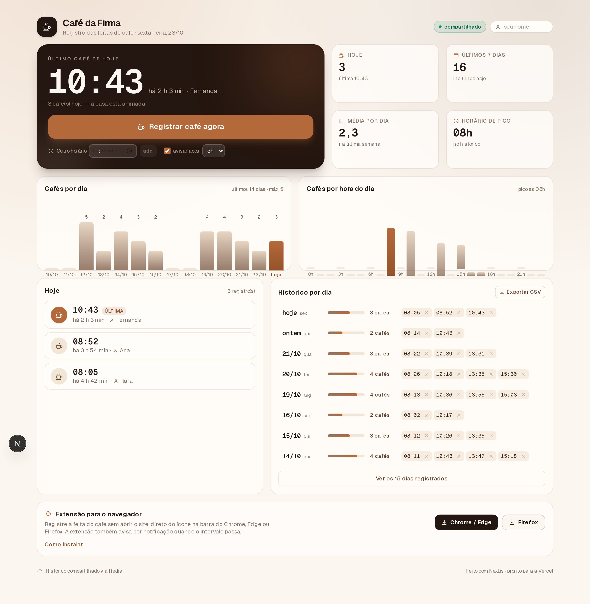
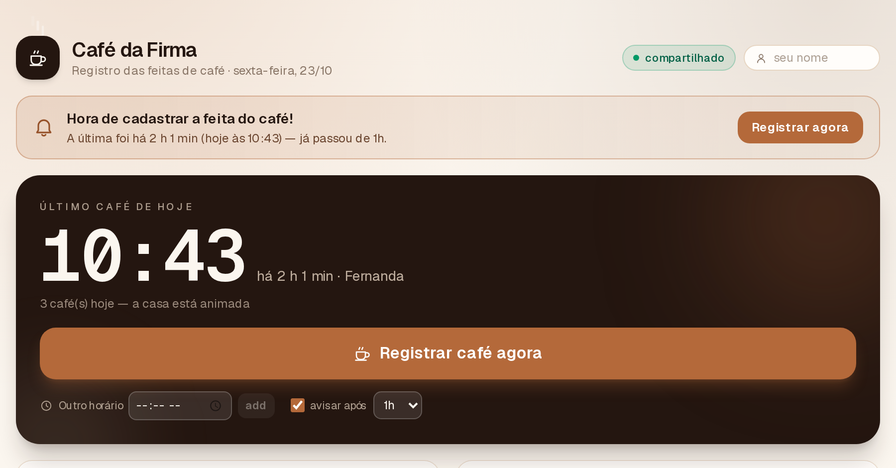
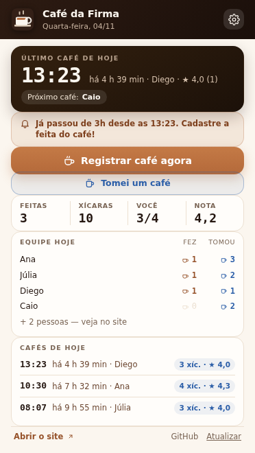

# ☕ Café da Firma

[](https://github.com/Amad3eu/cafedafirma/actions/workflows/ci.yml)
[](LICENSE)
[](https://nextjs.org)

Site para a equipe registrar as **feitas de café** (quando o café foi passado), as **xícaras** que cada pessoa tomou no dia e **como estava o café** naquele momento. Um clique registra o horário, um aviso aparece quando o intervalo passa, e o histórico com gráficos e ranking mostra quem faz o melhor café, quanto se bebe e em que período o café sai melhor.

Feito com **Next.js 16 (App Router) + React 19 + Tailwind CSS 4**, pronto para hospedar na **Vercel**, com **extensão para Chrome, Edge e Firefox** incluída. Código aberto (MIT) em **<https://github.com/Amad3eu/cafedafirma>**.



| Aviso de "hora do café" | Extensão no navegador |
| --- | --- |
|  |  |

---

## ✨ O que ele faz

### Feitas (quem faz o café)

- **Registrar café agora** — grava só o horário (e opcionalmente quem registrou). Também dá para registrar um horário passado ("Outro horário").
- **Aviso de "hora de cadastrar a feita"** — banner que aparece quando o último café passou do intervalo configurado (1h a 6h, ajustável na tela). Na extensão o mesmo aviso chega como notificação do navegador.
- **Cartão do último café** — horário em destaque, "há quanto tempo" e quem registrou.
- **Hoje** — lista dos cafés do dia, com botão para remover (e "Desfazer" no aviso que aparece após registrar).
- **Histórico por dia** — agrupado por data, com todos os horários, quantidade por dia e atalho para remover registros errados.
- **Gráficos** — cafés por dia (últimos 14 dias) e cafés por hora do dia, com destaque para o horário de pico.
- **Métricas** — hoje, últimos 7 dias, média por dia, horário de pico.
- **Exportar CSV** — baixa todo o histórico (`;` como separador, abre direto no Excel em pt-BR).
- **Funciona offline / sem banco** — se não houver banco configurado, o histórico fica no `localStorage` do navegador e o app avisa isso na tela.
- **Migração automática** — quando o banco é conectado, o app oferece importar para o histórico compartilhado os cafés que estavam salvos só no navegador (ou descartá-los).
- **Extensão de navegador** — registra o café sem abrir o site (clique no ícone, menu de contexto ou `Alt+Shift+C`), mostra o último café + contador do dia, avisa por notificação quando o intervalo passa, lembra o primeiro café do dia e avisa quando um colega registra (ex.: “Amadeu fez café ☕”).

### Xícaras e notas (quem toma o café) — novo na 1.7

- **Tomei um café** — cada pessoa conta as xícaras que tomou no dia. O site mostra "você: 2 de 4", quem tomou na equipe e o total do dia.
- **Como estava o café?** — depois de uma xícara, o app pergunta a nota (1 a 5 estrelas). A nota fica ligada à **feita que estava no bule** naquele momento (a última registrada até 12 h antes), então dá para saber se o café daquele período estava bom.
- **Meta diária** — sem meta ou de 2 a 8 xícaras, com medidor e aviso discreto ao passar.
- **Ranking da firma** — quem faz o melhor café (média das notas, mínimo de 3 avaliações), quem mais fez café nos últimos 30 dias e a nota por período do dia (manhã, almoço, tarde, noite).
- **Feitas × xícaras por dia** — gráfico de barras agrupadas com legenda, em paleta validada para daltonismo.
- **Quem faz o próximo?** — rodízio justo: quem tomou mais xícaras do que as próprias feitas renderam vai para a frente da fila ("É a vez de Caio: tomou 9, fez 1"). Sugestão também abaixo do botão de registrar e no popup da extensão.
- **Café fresco vale mais?** — nota média por idade do café na hora da xícara, com a conclusão em texto ("Depois de 1 h a nota cai de 4,3 para 2,9") e a nota típica do café que está no bule agora.
- **Na extensão** — botão "Tomei um café" com estrelas no popup, atalho `Alt+Shift+T`, item no menu do botão direito e notificação com botões 👍/👎 para avaliar sem abrir nada.
- **CSV** inclui as xícaras e as notas (coluna `tipo`: `feita` ou `xicara`).

---

## 🚀 Rodar localmente

Requisitos: Node.js 20.9+ (recomendado 20 ou 22).

```bash
npm install
npm run dev
```

Abra http://localhost:3000.

Em desenvolvimento, os cafés são salvos em `data/entries.json` e as xícaras em `data/cups.json` (modo arquivo). Para começar com dados de exemplo (feitas, xícaras e notas de 3 semanas):

```bash
npm run seed:demo           # gera ~3 semanas de histórico de exemplo
npm run seed:demo -- --clear  # limpa tudo
```

Scripts disponíveis:

| Comando | O que faz |
| --- | --- |
| `npm run dev` | servidor de desenvolvimento |
| `npm run build` | build de produção |
| `npm start` | roda o build de produção |
| `npm run lint` | ESLint |
| `npm run typecheck` | `next typegen` + `tsc --noEmit` |
| `npm test` | testes (formatação, estatísticas, helpers da API, consistência da extensão) |
| `npm run check` | lint + tipos + testes, o mesmo que a CI roda |
| `npm run build:ext` | sincroniza `extension/chrome` → `extension/firefox` e gera os zips |
| `npm run make:icons` | regenera os ícones (app + extensão) |
| `npm run seed:demo` | dados de exemplo / `-- --clear` limpa |

---

## ☁️ Deploy na Vercel

### 1. Suba o projeto para um repositório

```bash
cd cafe-tracker
git init
git add .
git commit -m "Café da Firma"
git branch -M main
git remote add origin https://github.com/SEU-USUARIO/cafe-da-firma.git
git push -u origin main
```

### 2. Importe na Vercel

1. Entre em <https://vercel.com/new>.
2. Escolha o repositório **cafe-da-firma**.
3. Framework detectado automaticamente: **Next.js** — não precisa mexer em nada (build `next build`).
4. Clique em **Deploy**.

Ou, pelo terminal:

```bash
npm i -g vercel
vercel        # preview
vercel --prod # produção
```

### 3. Crie o banco de dados (histórico compartilhado) ⚠️ importante

Sem banco, o site funciona, mas **cada pessoa vê só os próprios cafés** (ficam no navegador de cada um). Para o histórico ser o mesmo para a equipe toda:

1. No painel do projeto na Vercel, vá em **Storage** (ou *Marketplace*) → **Create Database** → **Upstash Redis** (plano gratuito serve bem).
2. Conecte o banco ao projeto — a Vercel injeta as variáveis automaticamente:
   - `UPSTASH_REDIS_REST_URL`
   - `UPSTASH_REDIS_REST_TOKEN`

   (Também funciona com os nomes `KV_REST_API_URL` / `KV_REST_API_TOKEN`.)
3. Faça um **Redeploy** (Deployments → ⋯ → Redeploy) para o app pegar as variáveis.

Pronto: o selo no topo do site passa de *"só neste navegador"* para **"compartilhado"**, e o histórico vale para todo mundo. O app guarda os últimos 12 meses automaticamente.

### Variáveis de ambiente

| Variável | Obrigatória | Para quê |
| --- | --- | --- |
| `UPSTASH_REDIS_REST_URL` | não (recomendada) | endpoint REST do Redis |
| `UPSTASH_REDIS_REST_TOKEN` | não (recomendada) | token do Redis |
| `KV_REST_API_URL` / `KV_REST_API_TOKEN` | não | alternativa (Vercel KV) |
| `STORAGE_URL` / `STORAGE_TOKEN` | não | integração criada com prefixo `STORAGE` |
| `<PREFIXO>_URL` / `<PREFIXO>_TOKEN` | não | qualquer prefixo customizado da integração |
| `CAFE_FILE_STORE=1` | não | força salvar em arquivo mesmo em produção (só use em servidor próprio) |
| `PRIVACY_CONTACT` | não | e-mail exibido na página `/privacidade` (padrão: `privacidade@cafedafirma.local`) |

> O app detecta automaticamente o par certo: procura primeiro os nomes conhecidos e,
> se não achar, varre o ambiente atrás de uma variável `*_URL` apontando para o Upstash
> com o token correspondente. Ou seja, **não importa o prefixo** escolhido na hora de
> conectar o banco (Production/Preview/Development).

Veja `.env.example`.

---

## 🧩 Extensão do navegador

O código está em `extension/chrome` (fonte da verdade) e `extension/firefox` (cópia automática; só o `manifest.json` é próprio). **Edite apenas em `chrome/`** e rode `npm run build:ext` — ele copia os arquivos compartilhados, regenera os ícones e empacota. A CI e o `npm test` falham se as duas pastas divergirem. Os zips prontos ficam em `public/` e também são baixados pelo próprio site, no card **"Extensão para o navegador"**.

- `public/extensao-cafe-chrome.zip`
- `public/extensao-cafe-firefox.zip`

Depois de mexer no código da extensão, gere os zips de novo:

```bash
npm run build:ext
```

### Instalar no Chrome / Edge (modo desenvolvedor)

1. Baixe e **descompacte** `extensao-cafe-chrome.zip`.
2. Abra `chrome://extensions` (ou `edge://extensions`).
3. Ligue o **Modo do desenvolvedor** (canto superior direito).
4. Clique em **Carregar sem compactação** e escolha a pasta descompactada.
5. Clique no ícone da extensão → **⚙ Configurações** → cole o endereço do seu site (ex.: `https://cafe-da-firma.vercel.app`) → **Salvar** → **Testar conexão**.

### Instalar no Firefox

1. Baixe `extensao-cafe-firefox.zip` e descompacte.
2. Abra `about:debugging#/runtime/this-firefox`.
3. **Carregar complemento temporário** → selecione o `manifest.json` da pasta.
4. Nas opções da extensão, cole o endereço do site e salve.

> No Firefox, complementos carregados assim são temporários (desaparecem ao fechar o navegador). Para uso fixo da equipe, publique na [AMO](https://addons.mozilla.org/developers/) (a extensão já tem `id` e `strict_min_version` definidos) ou instale em cada máquina.

### O que a extensão faz

- **Popup**: último café + "há quanto tempo" + nota da feita + sugestão de quem faz o próximo, aviso laranja quando passou do intervalo, botão **Registrar café agora**, botão **Tomei um café** (com as estrelas "como estava o café?"), métricas de feitas / xícaras / você / nota, quem fez e quem tomou hoje, lista dos cafés do dia com xícaras e nota por feita, e atalho para o site e para o repositório.
- **Badge no ícone**: número de feitas de hoje.
- **Notificações**: intervalo (manhã/tarde), primeiro café do dia, "colega fez café" e, ao registrar uma xícara pelo atalho ou menu, "como estava o café?" com botões 👍 (nota 4) / 👎 (nota 2).
- **Atalhos**: `Alt+Shift+C` registra a feita, `Alt+Shift+T` registra que você tomou um café, `Alt+Shift+P` abre o painel.
- **Opções**: endereço do site, seu nome, intervalos do aviso, primeiro café do dia, aviso de colega, meta de xícaras por dia, ação do clique no ícone, frequência de verificação, teste de conexão e de notificação.

---

## 🧩 Extensão: instalar, publicar e como o sistema funciona

Guia detalhado em [docs/EXTENSAO-E-SISTEMA.md](docs/EXTENSAO-E-SISTEMA.md): arquitetura,
fluxos, instalação em 2 minutos (carregar sem compactação), publicação no Chrome Web Store,
Edge Add-ons e Firefox AMO (com checklist e justificativa de permissões) e o checklist pós-deploy.

## 🔌 API

Todas as rotas aceitam CORS (`Access-Control-Allow-Origin: *`), para a extensão conseguir chamar o site.

### `GET /api/entries?days=60[&cups=1]`

```json
{
  "storage": "redis",
  "entries": [{ "id": "uuid", "ts": 1761214980000, "who": "Ana" }],
  "cups": [{ "id": "uuid", "ts": 1761215400000, "who": "Caio", "brewId": "uuid", "rating": 4 }]
}
```

`storage` pode ser `redis` (compartilhado), `file` (dev) ou `none` (sem banco → o app usa o navegador). `cups` só vem com `cups=1` — é uma única leitura no banco (pipeline), e é o que o site e a extensão usam.

### `POST /api/entries`

```json
{ "ts": 1761214980000, "who": "Ana" }
```

`ts` é opcional (padrão: agora; limitado aos últimos 60 dias). Resposta:

```json
{ "storage": "redis", "entry": { "id": "uuid", "ts": 1761214980000, "who": "Ana" } }
```

### `DELETE /api/entries?id=uuid`

```json
{ "storage": "redis", "removed": true }
```

### `GET /api/cups?days=60`

```json
{ "storage": "redis", "cups": [{ "id": "uuid", "ts": 1761215400000, "who": "Caio", "brewId": "uuid", "rating": 4 }] }
```

### `POST /api/cups`

```json
{ "who": "Caio", "rating": 4 }
```

Campos opcionais: `ts` (padrão: agora), `brewId`, `rating` (1–5), `note`. Sem `brewId`, a API liga a xícara à **última feita registrada até `ts`** (no máximo 12 h antes) — é "o café daquele período". Resposta: `{ "storage": "redis", "cup": { ... } }`.

### `PATCH /api/cups?id=uuid`

```json
{ "rating": 5 }
```

Define a nota (ou remove, com `"rating": null`). Aceita também `note`. Responde `404` se a xícara não existe.

### `DELETE /api/cups?id=uuid`

```json
{ "storage": "redis", "removed": true }
```

### `GET /api/health`

Diagnóstico do armazenamento sem expor segredos: variável detectada, host, teste de escrita/leitura, `total` (feitas), `totalCups`, `visibleToApp` e `visibleCups`.

Exemplo rápido com curl:

```bash
curl -X POST https://SEU-SITE.vercel.app/api/entries \
  -H 'Content-Type: application/json' -d '{"who":"Ana"}'
curl -X POST https://SEU-SITE.vercel.app/api/cups \
  -H 'Content-Type: application/json' -d '{"who":"Caio","rating":4}'
curl "https://SEU-SITE.vercel.app/api/entries?days=7&cups=1"
```

---

## 🗂 Estrutura

```
cafedafirma/
├─ app/
│  ├─ api/entries/route.ts   # GET (com ?cups=1) / POST / DELETE das feitas
│  ├─ api/cups/route.ts      # GET / POST / PATCH / DELETE das xícaras e notas
│  ├─ api/health/route.ts    # diagnóstico da persistência
│  ├─ manifest.ts            # web app manifest (site instalável)
│  ├─ privacidade/page.tsx   # política de privacidade (LGPD)
│  ├─ layout.tsx             # fontes, metadata, CSS global
│  ├─ page.tsx               # página principal (server) → <CoffeeApp />
│  ├─ icon.png               # favicon gerado
│  └─ globals.css            # Tailwind 4 + tokens de cor (café)
├─ components/
│  ├─ CoffeeApp.tsx          # estado, ações, avisos, layout
│  ├─ CupsCard.tsx           # "Tomei um café", meta, nota e quem tomou
│  ├─ RankingCard.tsx        # melhor café, quem mais fez, por período
│  ├─ RatingStars.tsx        # 5 estrelas (leitura ou interativas)
│  ├─ DayChart.tsx           # feitas × xícaras por dia (barras agrupadas)
│  ├─ HourChart.tsx          # feitas por hora
│  ├─ TodayList.tsx          # feitas de hoje, com xícaras e nota
│  ├─ HistoryList.tsx        # histórico agrupado por dia
│  ├─ StatCard.tsx           # cartões de métrica
│  ├─ ExtensionCard.tsx      # card de download/instruções da extensão
│  └─ Icons.tsx              # ícones SVG (sem dependências)
├─ lib/
│  ├─ store.ts               # persistência genérica: Redis → arquivo → nenhum
│  ├─ redis.ts               # cliente REST do Upstash/Vercel KV (fetch + pipeline)
│  ├─ stats.ts               # agregações puras (notas, rankings, períodos) — testadas
│  ├─ api.ts                 # helpers das rotas (CORS, validação) — testados
│  ├─ client-store.ts        # fetch + fallback localStorage + settings
│  ├─ format.ts              # datas, horas, "há x min", rótulos — testado
│  ├─ constants.ts           # DAY, URL do repositório, janelas de tempo
│  └─ types.ts               # CoffeeEntry (feita), CupEntry (xícara), Rating
├─ tests/                    # node --test (via tsx)
├─ extension/
│  ├─ chrome/                # fonte da verdade: manifest MV3 + popup + options + background
│  └─ firefox/               # cópia gerada por build:ext; só o manifest é próprio
├─ public/                   # zips das extensões + ícone
├─ scripts/                  # ícones, dados de exemplo, empacotamento da extensão
├─ docs/                     # guia da extensão/sistema e capturas
└─ data/                     # (dev) entries.json e cups.json — não vão para o git
```

---

## 🔐 Observações e próximos passos

- **Não há login**: quem tem o link registra e vê o histórico. Para uso interno, deixe o link só com a equipe. Se precisar de controle, os caminhos naturais são: Vercel Password Protection (plano Pro), um `?token=` na URL ou login com GitHub/e-mail.
- O app guarda no máximo **12 meses** de histórico (limpeza automática no Redis).
- Horários usam o **fuso do navegador** de quem registra/visualiza.
- As xícaras e notas são por **nome digitado**, sem login — a mesma confiança do resto do app.
- Ideias para depois: tipos de café (expresso, coado...), "quem faz o próximo" (rodízio), relatório mensal por e-mail/Slack e login opcional.

Histórico de versões em [CHANGELOG.md](CHANGELOG.md). Sugestões e problemas: [issues do repositório](https://github.com/Amad3eu/cafedafirma/issues).

Feito com Next.js 16 ⚡ e uma boa quantidade de café.

---

## 📄 Licença

MIT — veja [LICENSE](LICENSE). Use, modifique e compartilhe à vontade, mantendo o aviso de copyright.

## ✅ Integração contínua

O workflow [`.github/workflows/ci.yml`](.github/workflows/ci.yml) roda a cada push e pull request:

- **Site:** `npm ci` → `eslint` → `next typegen && tsc --noEmit` → `npm test` → `next build` (Node 22)
- **Extensão:** validação do `manifest.json` (MV3, permissões, ícones, background por navegador, versão igual à do `package.json`), checagem de que `firefox/` espelha `chrome/`, sintaxe dos scripts e `web-ext lint` da Mozilla (0 erros e 0 avisos obrigatórios)
